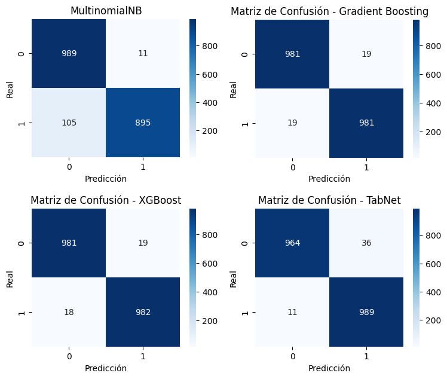
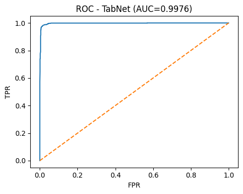

# Hate speech classification: Naive Bayes, Gradient Boosting, XGBoost, TabNet

Comparison of four supervised classifiers that label short messages as hate speech or not, written for a fictional company that wants to deploy such a classifier.

Course "Técnicas de Aprendizaje Automático" (Machine Learning Techniques), MSc in Artificial Intelligence, UNIR, February 2026.

**Team project (team of 2); I worked across the whole implementation.** Licence pending agreement with the team.

## What the notebook does

- Exploratory data analysis on a provided, simplified, already preprocessed dataset: the target classes are balanced and several variables separate the classes; engineered variables are informative but partly redundant.
- Trains four models: Multinomial Naive Bayes, Gradient Boosting, XGBoost and TabNet (a deep-learning model for tabular data).
- Evaluates each with accuracy, precision, recall, F1 and ROC-AUC, plus stratified k-fold cross-validation for several of them, and compares them in a final section.

The notebook text and comments are in Spanish.

## Stack

Python, scikit-learn, XGBoost, PyTorch, `pytorch-tabnet`, pandas, numpy, matplotlib, seaborn.

## Results

Hold-out test set of 2000 messages (1000 per class), values from the notebook outputs:

| Model | Accuracy | Precision | Recall | F1 | ROC-AUC |
|---|---|---|---|---|---|
| Multinomial NB | 0.942 | 0.988 | 0.895 | 0.939 | not computed |
| Gradient Boosting | 0.981 | 0.981 | 0.981 | 0.981 | 0.997 |
| XGBoost | about 0.982 | 0.981 | 0.982 | 0.982 | 0.997 |
| TabNet | 0.977 | 0.965 | 0.989 | 0.977 | 0.998 |

Confusion matrices (NB, Gradient Boosting, XGBoost, TabNet; labels in Spanish):



TabNet ROC curve:



## How to run (and limits)

The dataset is not included: it is a course-provided file (`out.csv`, simplified HateSpeech dataset) and cannot be redistributed. The notebook reads it from `../data/out.csv`, so it cannot be re-run without it; the stored outputs are the results above. The notebook shows three rows of the dataset (lemmatised tokens and numeric features).

```
pip install -r requirements.txt
jupyter notebook hate_speech_classification.ipynb
```

Package versions are not pinned because the notebook does not record them. The original assignment statement and the HTML export were removed; local-path warnings were cleared from the stored outputs.
